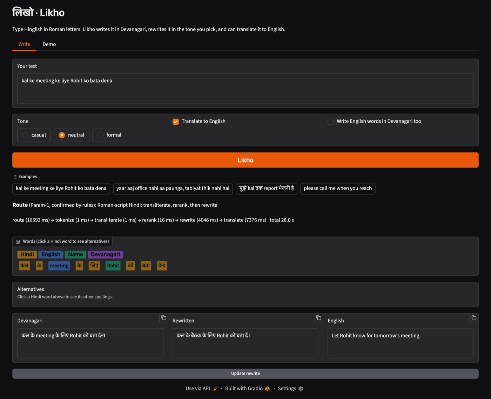
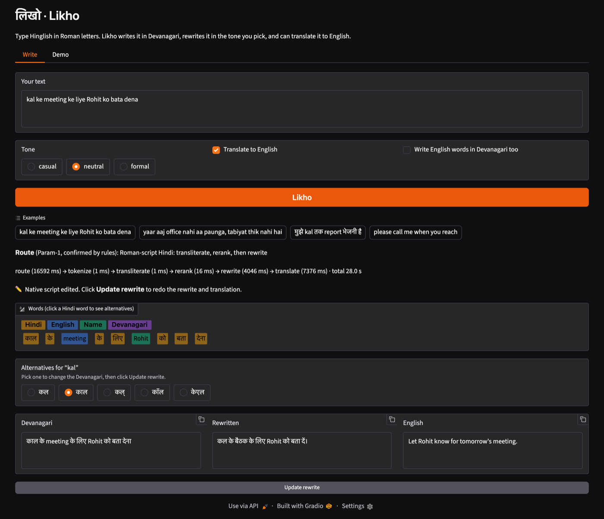

# Likho (लिखो)

**A Hinglish writing assistant.** Type Hindi the way people text it — in Roman
letters, mixed with English — and Likho writes it in Devanagari, rewrites it in
the tone you choose, and can translate it to English.

> `kal ke meeting ke liye Rohit ko bata dena`
> → **कल के meeting के लिए Rohit को बता देना**
> → *Let Rohit know for tomorrow's meeting.*

The hard part is not transliteration; it is deciding **which** words to
transliterate. *kal* is Hindi, *meeting* is English, *Rohit* is a name — only
the first should become Devanagari. Likho tags every word, transliterates only
the Hindi ones, lets you pick another spelling for any word, and explains how
it routed your text.

CS3235 (Working with LLMs) mini-project, RV University. Academic,
non-commercial use.



## Features

- **Roman → Devanagari** for the Hindi words only; English words and names stay
  as typed (a switch writes English words in Devanagari too).
- **Per-word alternatives.** Click a Hindi word to see the model's other
  spellings and pick one; the Devanagari updates immediately.
- **Tone rewrite** — casual, neutral or formal — by an LLM, checked by rules
  before it is shown.
- **English translation** of the result.
- **Explained routing.** An LLM agent proposes how to handle the input
  (Roman Hinglish, Devanagari, mixed script, English); rules verify the
  proposal, and the UI shows which stages ran and how long each took.
- **Graceful failure.** If a stage fails, the earlier results are kept and the
  failure is shown, never a blank screen.
- **Demo tab** with one-click showcase examples for presentations.



## How it works

```
text → Router (Param-1 + rules) → Tokenizer/Tagger → Transliterate (IndicXlit, top-5)
     → Rerank (lexicon + context) → Rewrite (Param-1 + rule check) → Translate (IndicTrans2)
```

| Stage | What it does | Model |
|---|---|---|
| Router | Picks the stages for this input; LLM proposes, rules verify | Param-1 2.9B Instruct |
| Tagger | Labels each word Hindi / English / name / Devanagari / number / punctuation | lexicons + Param-1 tie-break |
| Transliterate | Top-5 Devanagari candidates per Hindi word | IndicXlit |
| Rerank | Chooses among the candidates using word frequency and context | — |
| Rewrite | Rewrites in the chosen tone; rejected if it changes script or length too much | Param-1 2.9B Instruct |
| Translate | Devanagari → English | IndicTrans2 indic-en 1B |

The UI (Gradio) is a thin client of a FastAPI service; no model is ever called
from the UI. Details: [`docs/ARCHITECTURE.md`](docs/ARCHITECTURE.md),
[`docs/MODELS.md`](docs/MODELS.md).

## Install

Requires Python 3.10. [`uv`](https://github.com/astral-sh/uv) is recommended
(it installs Python 3.10 itself); without it, `python3.10` must be on `PATH`.

```bash
git clone <this repo> && cd likho
make setup          # .venv + pinned core dependencies — enough for the mock mode
```

**Try it without any models** (no GPU, no downloads; every stage returns a
deterministic stub, so the rewrite just echoes its input):

```bash
make test                     # 200+ tests, MOCK_MODELS=1
MOCK_MODELS=1 make api        # terminal 1: API on :8000
make dev                      # terminal 2: UI on http://127.0.0.1:7860
```

**Real models** — about 17 GB of downloads on first use: Param-1 (5.4 GB) and
IndicTrans2 (3.8 GB) go to the Hugging Face cache, IndicXlit's models and
dictionaries (7.5 GB) into the venv. A C compiler is needed to build fairseq,
and 16 GB of RAM is enough:

```bash
make setup-models
cp .env.example .env          # then set MOCK_MODELS=0 and HF_TOKEN
```

IndicTrans2 is gated: log in to Hugging Face, accept the terms on
[ai4bharat/indictrans2-indic-en-1B](https://huggingface.co/ai4bharat/indictrans2-indic-en-1B),
and put a read token in `HF_TOKEN`. Then `make api` and `make dev` as above.
The API loads all models at start-up (about a minute), and `/health` reports
which loaded; a model that fails to load disables only its own stage.

**Speed.** On an Apple M4 a request takes about 10–13 s with every stage on,
most of it two Param-1 calls (router and rewrite). Setting `LLM_ROUTER=0` in
`.env` skips the router's LLM call and saves about 6–7 s; routing accuracy on
the test set is the same (100%) with rules alone.

## Results

From evaluation run **`20261105-m4`** (Apple M4, real models). Every number
below is in [`results/`](results/README.md), generated from the committed run
in `eval/results/`; the run reproduces exactly with `--compare`.

| What | Result | Target (PRD §7) |
|---|---|---|
| Token classification macro-F1 (Hindi / English / name) | 94.4% | ≥ 85% ✅ |
| Router accuracy (30 inputs) | 100% | ≥ 90% ✅ |
| Rewrite meaning, LLM judge (1–5) | 4.28 | ≥ 4.0 ✅ |
| Translation chrF++ (gold Devanagari) | 75.0 | ≥ 45 ✅ |
| Transliteration CER, single words | 0.095 | ≤ 0.15 ✅ |
| Transliteration top-1 / top-5, single words | 58% / 78% | ≥ 70% / 90% ❌ |

On the 50 hand-built code-mixed sentences:

| | Likho | Transliterating every word (library default) |
|---|---|---|
| Sentences exactly right in Devanagari | 35/50 | 11/50 |
| English words kept as typed | 64/64 | 0/64 |
| Names kept as typed | 11/14 | 0/14 |
| Character error rate | 0.029 | 0.234 |

19 of 50 sentences pass every stage end to end. The biggest problem found is
in the rewrite: Param-1 converts English words the user typed (office →
कार्यालय) in every rewrite of a sentence that has them, against the
requirement to keep them. The full analysis, with case IDs and proposed fixes,
is in [`results/FAILURE_ANALYSIS.md`](results/FAILURE_ANALYSIS.md).

Reproduce: `MOCK_MODELS=0 make eval`, then compare with
`.venv/bin/python -m eval.run_eval --compare eval/results/20261105-m4_metrics.json`.

## Repository

```
likho/      core pipeline: router, tagger, transliterate, rerank, rewrite, translate
api/        FastAPI service (the only place models are loaded)
app/        Gradio UI — HTTP client of the API
eval/       evaluation harness, test sets, committed runs
results/    report-ready results of run 20261105-m4 + failure analysis
docs/       PRD, architecture, models, evaluation, tasks, report
```

Commands: `make setup | setup-models | api | dev | test | lint | eval | results RUN=<id>`.
Contributor rules are in [`CLAUDE.md`](CLAUDE.md).

## Licences

| Component | Licence |
|---|---|
| This project's code | Academic coursework; non-commercial use |
| IndicXlit (`ai4bharat-transliteration`) | MIT |
| IndicTrans2 indic-en 1B | MIT (gated on Hugging Face) |
| Param-1 2.9B Instruct | Model card: Apache-2.0 (metadata) / MIT (text); research use only |

See [`docs/MODELS.md`](docs/MODELS.md) §1 for the licence notes. Param-1's card
restricts it to research and experimentation, so do not deploy Likho as a
public product.

## Team

CS3235 Working with LLMs, RV University.

- Samarth Sanjay Pyati
- *(add the other team members)*

## Docs

[`docs/PRD.md`](docs/PRD.md) (scope) ·
[`docs/ARCHITECTURE.md`](docs/ARCHITECTURE.md) ·
[`docs/MODELS.md`](docs/MODELS.md) ·
[`docs/EVALUATION.md`](docs/EVALUATION.md) ·
[`docs/TASKS.md`](docs/TASKS.md) ·
[`docs/REPORT.md`](docs/REPORT.md) ·
[`docs/DEMO_SCRIPT.md`](docs/DEMO_SCRIPT.md) ·
[`results/`](results/README.md)
